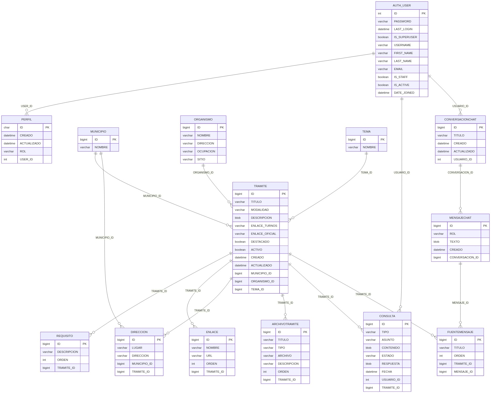
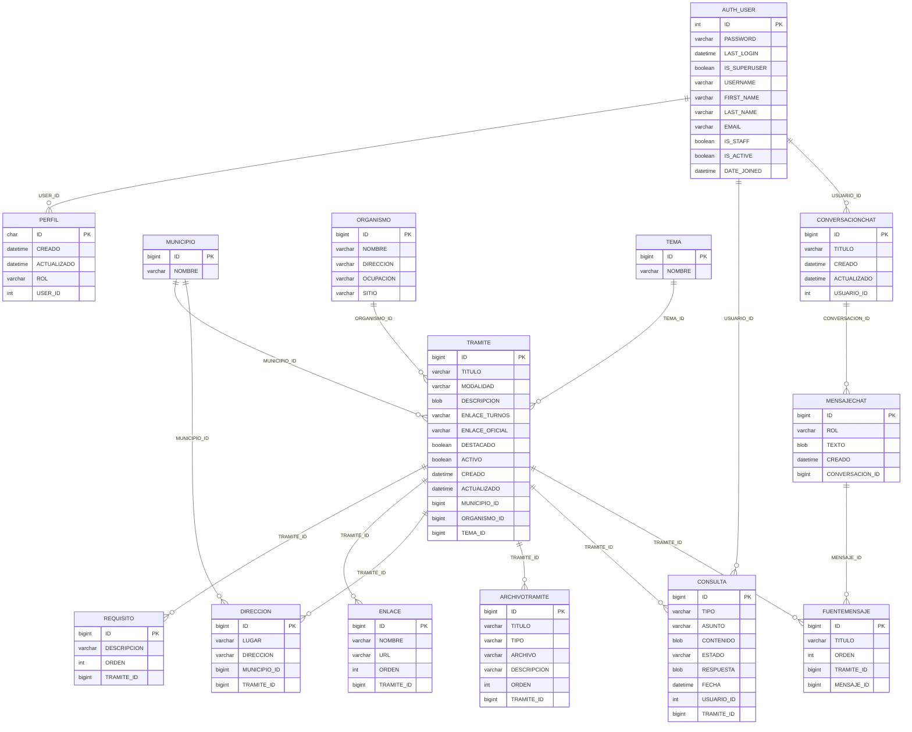

# Esquema de la base (diagrama ER)

Generado a partir de la base real (`datos/firebird/munitramites.fdb`).
Refleja las tablas del dominio y sus claves foráneas.

- `PK` = clave primaria.
- Las líneas `||--o{` son relaciones uno-a-muchos (una fila de la izquierda
  puede tener muchas de la derecha).
- Las tablas de Django (`DJANGO_*`, `AUTH_*` internas) se omiten salvo
  `AUTH_USER`, que es la cuenta de usuario.
- `PERFIL` es la extensión de `AUTH_USER` que guarda el rol.

Para verlo renderizado en VS Code: abrí este archivo y apretá `Ctrl+Shift+V`
(vista previa). La extensión **Markdown Preview Mermaid Support** ya está
instalada, así que el bloque de abajo se dibuja solo.

